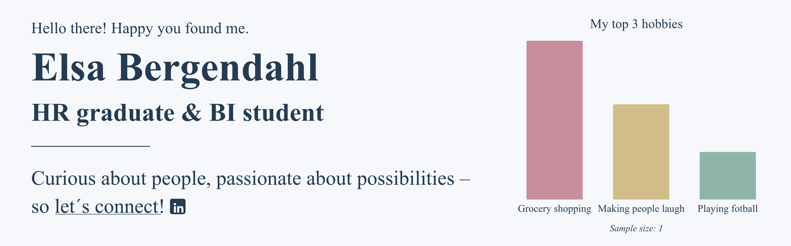

## About me

With an academic background in Human Resources and ongoing studies in Business Intelligence at Nackademin, I am passionate about combining people and data to support informed business decisions.

## Areas of interest

- People Analytics
- Business Intelligence
- Data Visualization
- Business Development

## Tools & Technologies

- Power BI
- Power Query
- DAX
- Excel
- SPSS

## Let's connect

[LinkedIn](https://www.linkedin.com/in/elsa-bergendahl-aa730227b)
